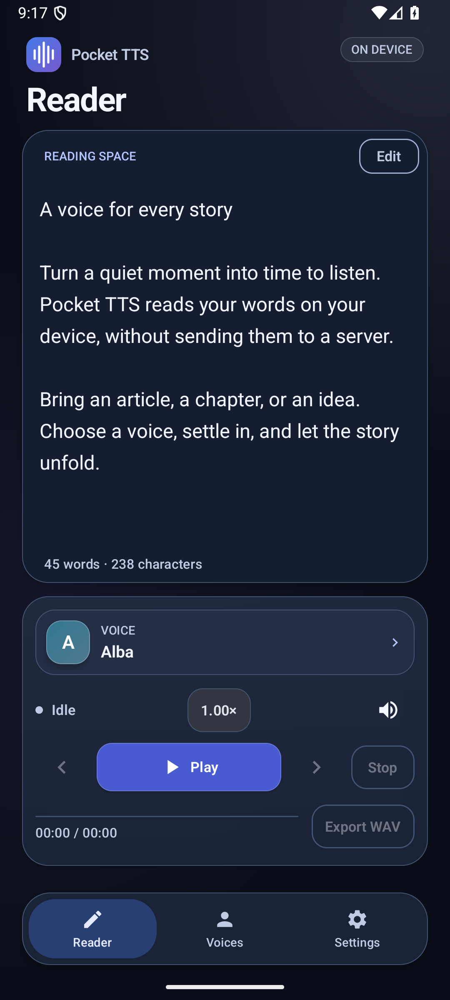
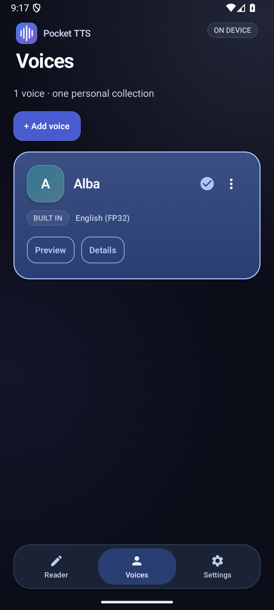
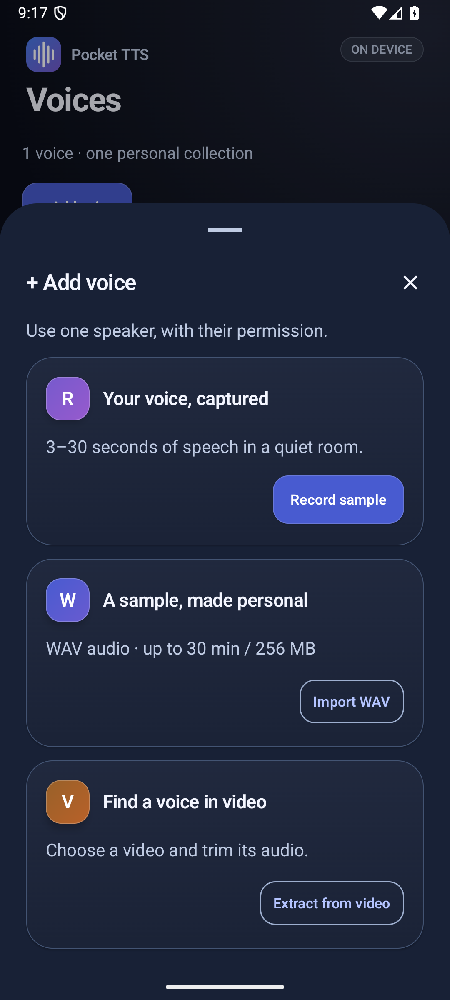
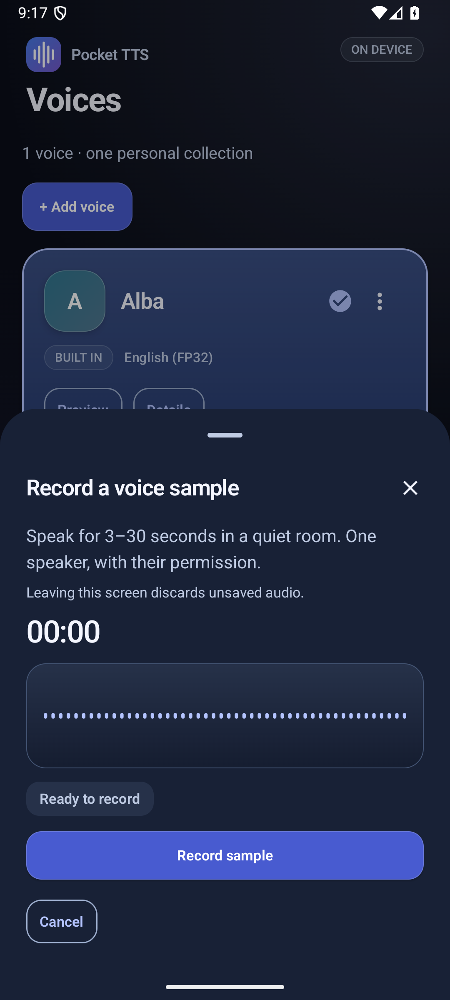
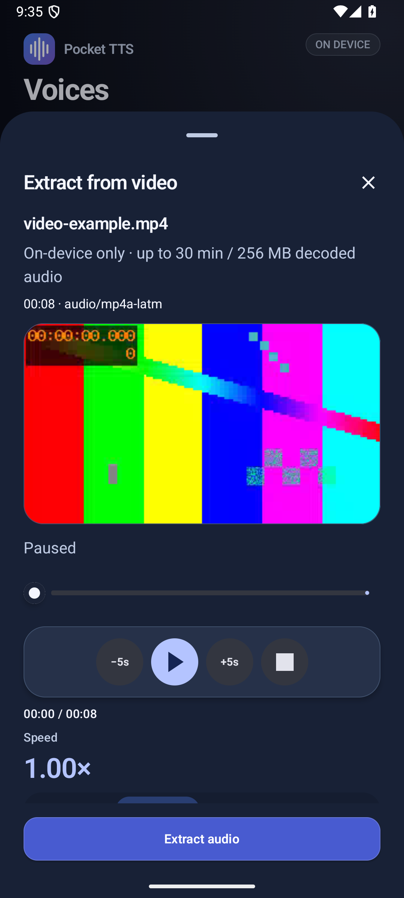
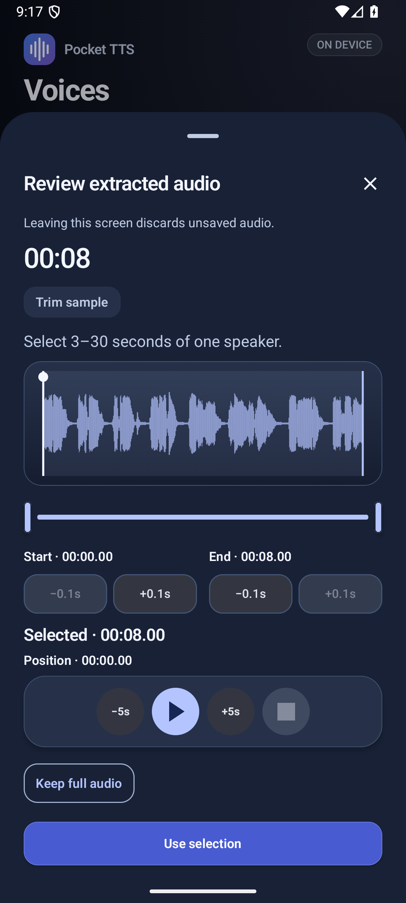
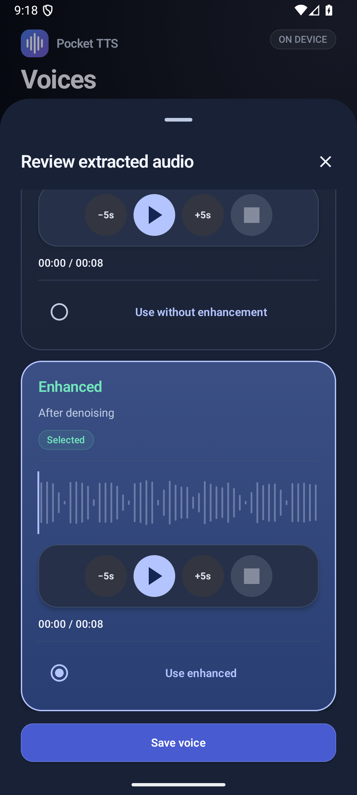
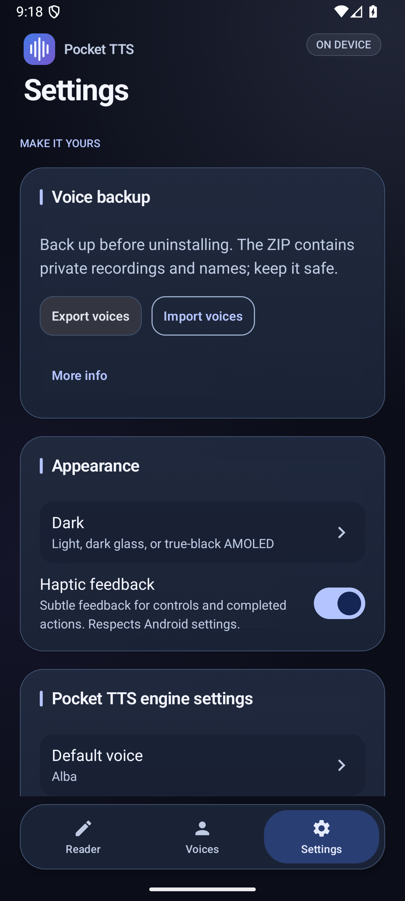
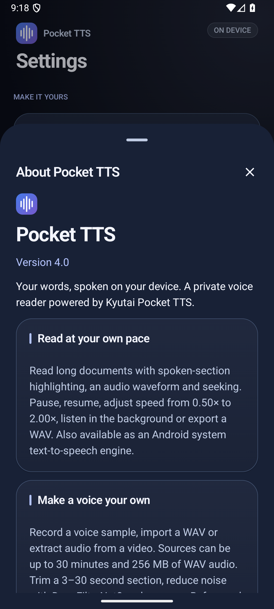

# PocketTTS for Android

**Offline speech. Your words. Your voices.**

PocketTTS is an Android text-to-speech app with a long-form Reader, custom voice creation and on-device audio editing. Listen to documents, make a voice from a recording or video, and keep your text and audio on your device.

**Version 4.0 · Android 8.0+ · ARM64 · English FP32 model and Alba voice included**

An unofficial community application powered by Kyutai Pocket TTS and PocketTTS.cpp, not an official Kyutai application.

## Demo


[Explore the app in screenshots](#screenshots).

## Features

### Read and listen

- A large, scrollable text editor with editing and distraction-free reading modes.
- Long-form reading with automatic chunking, spoken-section highlighting and scroll following.
- Play, pause, resume, stop, Previous/Next chunk navigation and waveform seeking.
- Playback speed from **0.50× to 2.00×**, with an exact **1.00× reset**.
- **Per-voice Reader amplification**, remembered independently for each voice.
- Background playback with Android notification, lock-screen and media-session controls.
- Export completed speech as a **WAV file**.
- Use PocketTTS as an **Android system TTS engine** in compatible apps.

### Create your voice library

- Clone a voice from an authorized reference sample, without training a new model.
- Record with a live microphone waveform and duration display.
- Import WAV audio or **extract audio from a video**.
- Select voices directly from the library, audition references and manage custom names.
- Export individual references or create **portable ZIP backups** of your custom library.

### Edit and enhance audio

- Trim with a waveform, selection handles and **0.1-second adjustments**.
- Adjust reference gain and retain saved editing settings when reopening a voice.
- **Loudness normalization** calibrated against the bundled reference, with peak protection.
- Bundled **DeepFilterNet3** noise reduction with original/enhanced previews.
- Choose either version before saving; preserve the source for **Restore Original**.
- Edit, rename, restore, export or delete custom voices without replacing their identity.

### A focused Android experience

- Rounded Material 3 surfaces, clear typography and restrained glass-style layers.
- **System, Light, Dark and AMOLED** appearance modes.
- Floating navigation, safe heading swipes and deliberate hold-and-drag tab selection.
- Optional, subtle haptic feedback that respects Android settings.
- Inference, voice conditioning, enhancement and video extraction run locally.

## Screenshots

Actual application captures. Audio examples use attributed reference or synthetic material; no private recordings are shown.

<table>
<tr>
<td align="center"><br>Reader</td>
<td align="center"><br>Voice library</td>
<td align="center"><br>Add a voice</td>
</tr>
<tr>
<td align="center"><br>Recording</td>
<td align="center"><br>Extract from video</td>
<td align="center"><br>Trim audio</td>
</tr>
<tr>
<td align="center"><br>Enhance audio</td>
<td align="center"><br>Settings</td>
<td align="center"><br>About</td>
</tr>
</table>

## Get started

APK downloads are published through [GitHub Releases](https://github.com/Rafin14/PocketTTS/releases). You can also [build from source](docs/BUILDING.md).

1. Install the ARM64 APK and open PocketTTS. First launch prepares the included model locally.
2. Open **Reader → Edit**, paste or type text, choose a voice and press **Play**.
3. Open **Voices → Add voice** to record, import a WAV or extract video audio.
4. Trim and preview the sample, compare enhancement, name it and save.
5. Use **Settings → Voice backup** to export or restore your custom library.

For other apps, select PocketTTS under Android's **Text-to-speech output** settings. The location varies by device.

Updates require the same application ID and signing identity as the installed app. Before uninstalling, changing builds or signing keys, export your voices and copy any Reader text you want to keep. Uninstalling removes app-private data.

## Offline and private

The app has **no INTERNET permission**. PocketTTS and DeepFilterNet3 models are packaged with the app; no runtime model download is needed. Automatic Android backup is disabled for app data.

Android's document picker may access cloud providers that download or sync files independently. Exported files go to the destination you choose. Voice-backup ZIPs contain recordings and are **not encrypted**.

Only use voices and recordings you are authorized to use. Do not impersonate people without consent or present generated speech as an authentic recording.

## Compatibility and limits

- Android 8.0+ on **ARM64**. Native PocketTTS synthesis is not supported on x86 emulator translation.
- The included model supports **English**; the app does not download additional language packs.
- Microphone recordings and selected enhancement references use **3–30 seconds**.
- Source WAVs and decoded video audio support up to **30 minutes** and **256 MiB**. Video limits concern decoded audio, not compressed file size.
- WAV import supports mono/multichannel PCM and floating-point formats. Selected references become 24 kHz mono PCM16.
- Video compatibility depends on Android codecs. Protected, corrupt or non-seekable sources may be rejected.
- Noise reduction is not speaker separation and cannot reliably remove music, strong echo or overlapping speech.
- Allow approximately **420 MiB** for extracted Pocket assets, in addition to the APK, voices, generated audio and temporary files. Speed and quality depend on the device and sample.
- Highlighting follows speech chunks, not individual words. Generated speech is temporary until exported.

## Documentation

| Guide | Topics |
| --- | --- |
| [Reader](docs/READER.md) | Documents, playback, chunks, amplification and WAV export |
| [Voices](docs/PLAYBACK_AND_VOICE_EDITING.md) | Selection, previews, saved edits, restoration and export |
| [Trimming and speed](docs/TRIMMING_AND_SPEED.md) | Waveforms, gain, normalization, audio formats and playback rate |
| [Video extraction](docs/VIDEO_VOICES.md) | Video-to-reference workflow and codec limits |
| [Noise reduction](docs/DEEPFILTER.md) | Processing, limitations and attribution |
| [Voice backups](docs/VOICE_BACKUP.md) | Portable exports, restoration and privacy |
| [Appearance and navigation](docs/READER_MODES_AND_ABOUT.md) | Themes, modes, gestures and haptics |
| [Audio limits and accessibility](docs/AUDIO_LIMITS.md) | Supported input and accessible controls |
| [Build guide](docs/BUILDING.md) | Android Studio, command-line setup and signing |

## Build from source

Install Git LFS, JDK 17 or 21, Android SDK Platform 35, NDK 27.2.12479018 and CMake 3.22.1. Native dependency preparation uses Bash, curl, unzip, tar and sha256sum.

```bash
git clone https://github.com/Rafin14/PocketTTS.git
cd PocketTTS
git lfs install
git lfs pull
bash scripts/prepare_android_native_deps.sh
./gradlew :app:assembleDebug
```

On Windows, prepare native dependencies with Git Bash or WSL, then run `.\gradlew.bat :app:assembleDebug` in PowerShell. Android Studio users can open the repository root, sync Gradle and run the `app` module.

Output: `app/build/outputs/apk/debug/app-debug.apk`. Initial dependency downloads require internet access; the installed app operates offline. See the [build guide](docs/BUILDING.md) for SDK setup, debug identities and release signing.

The required `PocketTTS-english-FP32.zip` uses **Git LFS**. Keep this archive, the DeepFilter model, voices, tokenizer and license notices when building or distributing the app.

## Contributing

See [Contributing](CONTRIBUTING.md) for development guidance and [Security](SECURITY.md) for vulnerability reporting.

## Licenses and attribution

Application code is [MIT-licensed](LICENSE). Models, recordings and third-party software retain their own licenses.

- Pocket TTS/PocketTTS.cpp code: MIT. Model derivatives and Alba have separate attribution requirements; see [model licensing](MODEL_LICENSE.md) and [voice attribution](VOICE_ATTRIBUTION.md).
- DeepFilterNet3 model: MIT; adapted speech-core DSP/resampler: Apache-2.0; KissFFT: BSD-3-Clause.
- ONNX Runtime: MIT; SentencePiece, AndroidX/Compose and Kotlin: Apache-2.0; dr_libs: public-domain/MIT-0 options.

See [Third-party notices](THIRD_PARTY_NOTICES.md), [packaged licenses](app/src/main/assets/licenses/) and [DeepFilter notices](app/src/main/assets/deepfilter/NOTICES.txt).
